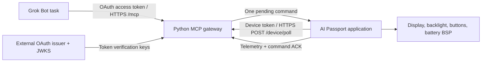

<p align="right">
  <a href="grok-bot-mcp.zh_CN.md">简体中文</a> · <strong>English</strong>
</p>

# Grok Bot device control through MCP

## Scope and delivery status

Phase 1 lets a Grok Bot read AI Passport status, show or clear a short message,
and change the backlight through a custom MCP connector. The device makes
outbound HTTPS requests to a gateway; it does not expose a server on the local
network. Continuous voice conversation is postponed. This increment does not
record audio, call the microphone, wake a Bot, or implement arbitrary GPIO,
shell, file, or firmware-update tools.

The implementation uses official interfaces: Grok custom MCP connectors,
the official Python MCP SDK, and ESP-IDF networking APIs. It does not copy
browser sessions or call undocumented Grok Bot endpoints. No documented API
for binding a named Bot directly to this ESP32 has been established. Here,
"binding" means authorizing the connector, selecting it for a Bot task, and
mapping the gateway to one configured device.

The user requested source and a plan without testing. At this delivery:

```text
Build: NOT RUN
Host tests: NOT RUN
Device tests: NOT RUN
Unverified: dependency installation, OAuth/provider compatibility, public HTTPS
deployment, Grok Bot connector discovery, firmware build, TLS/network behavior,
display rendering, command acknowledgements, resource use, and device controls.
```

No gateway, tunnel, cloud deployment, API call, or flashing is performed as part
of generating this code. The setup and acceptance instructions below are future
steps, not completed checks.

## Official integration boundary

Grok documents custom connectors at `grok.com/connectors`: choose **New
Connector**, **Custom**, enter the MCP URL, and complete authentication. The
connector exposes the server's tools to conversations. See the official
[Connectors guide](https://docs.x.ai/grok/connectors).

Grok must reach the MCP server over the public Internet. A private LAN address
or `localhost` is not a valid remote connector destination. A hosted gateway or
an authenticated public HTTPS tunnel is required; a tunnel provides reachability,
not authorization. See [Custom MCP Server Tunneling](https://docs.x.ai/grok/connectors/custom-mcp-tunneling).

Grok Bot documents installing connectors through **Connect apps** and attaching
one to a task with `@`. Installed connectors are account-wide. Naming one Bot as
the device assistant is a behavioral choice, not a security boundary against
other Bots on that account. The exact custom-connector availability and OAuth
flow in the target account still need verification. See [Use the computer and
apps](https://docs.x.ai/grok-bot/computer-and-apps).

## Architecture and ownership



| Component | Responsibility |
| --- | --- |
| Grok connector | Discover the five MCP tools and request permitted operations |
| External OAuth provider | Authenticate the owner, obtain consent, issue access tokens, and publish discovery/JWKS metadata |
| Python gateway | Verify OAuth tokens, validate inputs, queue bounded commands, and report telemetry and ACK status |
| Device poll worker | Connect Wi-Fi, obtain time for TLS, poll the gateway, and exchange telemetry/ACKs |
| Application state and UI | Apply supported commands, enforce local control, and render a dedicated device-control screen |
| Existing BSP | Own display, backlight, buttons, battery, pins, and shared hardware resources |

The Kconfig option `CONFIG_PASSPORT_GROK_MCP` selects this separate application.
It defaults to `n`, preserving the baseline hardware-test demo. CMake selects
the application sources from that option. The new application has
its own startup and screen; it does not extend the demo menu or reuse the demo
visual shell. It does not change BSP APIs, pin mappings, or the partition table.
It uses bundled ESP-IDF networking components and adds no external firmware
component package.

The application sources are [grok_app.c](../../../main/grok_app.c),
[grok_protocol.c](../../../main/grok_protocol.c), and
[grok_network.c](../../../main/grok_network.c). The gateway entry point is
[server.py](../../../gateway/grok_bot/server.py); its configuration, token
verification, and command state are separate modules in the same directory.

## Tools and command contract

| Tool | Input and effect |
| --- | --- |
| `passport_get_status` | Return the latest device telemetry, its freshness, and remote-control state |
| `passport_display_message(text)` | Queue 1 to 160 characters of printable ASCII text or newlines |
| `passport_clear_message` | Queue removal of the displayed message |
| `passport_set_backlight(brightness)` | Queue an integer brightness from 10 to 100 percent |
| `passport_get_command_status(command_id)` | Look up the receipt and outcome of a previously returned command ID |

Chinese, other non-ASCII characters, and control characters other than newline
are rejected by the
message API. This is an explicit phase-1 capability boundary: the baseline
Montserrat font cannot display arbitrary Chinese text. Chinese support requires
the separate [font integration workflow](lvgl-chinese-fonts.md), including glyph
coverage and device rendering checks.

The poll interval is 2 seconds. Each authenticated `POST /device/poll` reports
current state and any command acknowledgement; its response contains at most
one command. The device uses a separate credential from the MCP OAuth token.
The gateway keeps at most eight pending commands, including one in-flight
command, with a 30-second lifetime from enqueue. It retains at most 64 terminal
command results. Expiry stops further dispatch and marks an unacknowledged
command expired; it cannot recall a command already delivered or undo its effect.

A successful MCP write call means the gateway accepted a command, not that the
screen changed. The Bot must follow the returned command ID until the device
acknowledges it before claiming success. A timeout, rejection, or missing ACK
must remain visible. An ACK confirms firmware handling, not independent visual
inspection of the display.

| Command status | Meaning |
| --- | --- |
| `queued` | Accepted and waiting for a poll; `execution=not_sent` |
| `dispatched` | Sent to the device; `execution=unconfirmed` until ACK |
| `acknowledged` | Device reported success; `execution=confirmed` |
| `device_error` | Device reported rejection/failure; `execution=failed` |
| `expired` / `cancelled` | No further dispatch; previously sent work remains `unconfirmed` without ACK |
| `unknown` | ID is absent after restart or history eviction; never evidence of success |

Repeated polls may receive the same in-flight ID until ACK. The firmware
suppresses duplicate application within the current boot. Repeating an MCP
write tool call creates a new command; clients should query an existing ID
instead of automatically resubmitting after an uncertain outcome.

If no valid poll arrives for 15 seconds, status is offline; old telemetry must
retain its age rather than masquerade as current data. The gateway cancels old
pending/in-flight work when the device reports a new boot or remote control is
disabled. The device also rejects remote operations while locally disabled.
Disabling control is a local override; it is not an OAuth credential revocation.

The gateway is a single process with ephemeral state. Restarting it discards
queued commands, command history, and last-seen telemetry; clients reconnect
and the device supplies fresh state. Do not run multiple workers or replicas
against this in-memory store. Commands are not promised across a gateway
restart or device reboot.

## Local screen and controls

The screen shows the application title, connection and remote-control status,
the current message, and battery level in the top-right corner. Missing battery
telemetry is shown as unavailable, not as zero charge. Status and messages use
the existing ASCII-capable fonts.

| Control | Behavior |
| --- | --- |
| `OK` click | Pause remote control immediately; resume after the gateway confirms the pause |
| `UP` / `DOWN` click | Adjust brightness locally |
| `OK` long press | Clear the current message |
| 60 seconds without interaction | Dim the backlight to 10 percent |
| A local key or accepted remote command | Wake the display from idle dimming |

Remote control starts enabled only after the local configuration is valid.
Missing configuration must leave an explanatory screen and keep remote control
unavailable. Remote disable takes priority over incoming commands. Configuration
and control are distinct from microphone permission; this phase never enables
audio capture. After pausing, the device keeps remote control disabled until a
valid response to a paused poll confirms that no command remains to dispatch.
Pressing `OK` again before that response does not resume control. While offline,
the device stays paused; local brightness and message clearing remain available.

Button callbacks only enqueue input. Separate control and network tasks exchange
bounded copies of requests, results, and connection state. The network task
never accesses LVGL objects. The control task holds `bsp_lvgl_lock()` for screen
changes, and the screen remains alive for the entire boot. Slow DNS, TLS, or HTTP
calls therefore do not block local controls. HTTP operations use a 4-second
timeout and deadline checks between SDK calls; a blocking SDK call can exceed
that deadline. A request still pending after 6 seconds shows an unresponsive
gateway status while local controls continue to run.

## Authentication and deployment requirements

The gateway is an OAuth resource server, not an OAuth authorization server.
Use an external provider that can satisfy all of these requirements:

- Authorization Code with PKCE, and a client-registration path supported by
  the target Grok custom connector.
- RS256-signed JWT access tokens and an HTTPS issuer/JWKS endpoint.
- The configured public MCP resource URL as the token audience, and the
  `passport:control` scope.
- Owner-only access. Provider policy and the gateway's configured owner
  allowlist must agree; successful login by an unrelated account is not enough.

The gateway must validate signature, issuer, audience, expiry, owner identity,
and required scope. An ID token is not a substitute for an API access token.
Provider registration and actual Grok compatibility are required external setup;
the code does not make an arbitrary identity provider compatible automatically.
Access tokens must also contain a nonempty `client_id` or `azp` claim. Configure
the provider's access-token claim mapping accordingly.

The device credential is an independent random token scoped to the configured
device. Keep it out of prompts, URLs, logs, and tracked files. Use public HTTPS
with a valid certificate on both routes; the device verifies certificates with
the ESP-IDF bundle and synchronizes time before opening TLS connections. Do not
replace verification with an insecure TLS switch to accommodate a local server.
The current time service is `pool.ntp.org`; the network must permit DNS and
outbound SNTP over UDP port 123. Failed time synchronization prevents TLS polling.

Firmware configuration belongs in ignored `main/grok_local_config.h`, copied
from `main/grok_local_config.example.h`. It contains Wi-Fi SSID/password, the
public HTTPS gateway origin, the device ID, and the device token. This avoids
committing secrets but does not encrypt firmware or Flash: protect build
artifacts and the physical device. No credential is embedded in the committed
example. Provisioning credentials through a phone is a separate future feature.

| Local firmware macro | Meaning |
| --- | --- |
| `GROK_WIFI_SSID` / `GROK_WIFI_PASSWORD` | Local 2.4 GHz Wi-Fi credentials |
| `GROK_GATEWAY_URL` | HTTPS origin only, without path/query/trailing slash |
| `GROK_DEVICE_ID` | Device ID matching the gateway |
| `GROK_DEVICE_TOKEN` | Independent device credential matching the gateway |

Use a stable public origin for the gateway and align OAuth audience/resource
URLs with the final `/mcp` URL. Terminate public TLS at the selected hosting
platform or reverse proxy. Expose only the gateway routes needed for MCP,
metadata, and device polling. Deployment, hosting costs, domain setup, OAuth
registration, and connector authorization remain outside this source-only task.

## Future setup and build

Run these steps only when proceeding with environment setup and validation.
They have not been executed for this delivery.

1. Configure an external OAuth provider and a public HTTPS gateway endpoint.
   Match the issuer, audience/resource URL, owner, and scope described above.
2. Configure and start one gateway process using its
   [requirements](../../../gateway/grok_bot/requirements.txt) and
   [environment example](../../../gateway/grok_bot/.env.example). Use Python
   3.11 or later. Dependencies are pinned to `mcp==1.26.0` and
   `PyJWT[crypto]==2.10.1`; installation and vulnerability audits have not run.
   Keep real credentials in local environment configuration or the hosting
   platform's secret store.

   ```powershell
   python -m venv gateway/grok_bot/.venv
   .\gateway\grok_bot\.venv\Scripts\python.exe -m pip install -r gateway/grok_bot/requirements.txt
   # Export the required environment variables before starting the server.
   .\gateway\grok_bot\.venv\Scripts\python.exe -m gateway.grok_bot.server
   ```

   The example file is not loaded automatically. Export its values into the
   process environment. Required variables are `PASSPORT_PUBLIC_URL` (ending
   in exactly `/mcp`), `PASSPORT_OAUTH_ISSUER`, `PASSPORT_OAUTH_JWKS_URL`,
   `PASSPORT_OAUTH_SUBJECT` (the owner's exact JWT `sub`), `PASSPORT_DEVICE_ID`,
   and `PASSPORT_DEVICE_TOKEN` (32 to 128 random URL-safe characters).
   `PASSPORT_PORT` defaults to 8080. `PASSPORT_ALLOWED_ORIGINS` optionally lists
   exact HTTPS browser origins separated by commas; an empty list accepts
   clients without an Origin header and rejects browser origins.

   The server binds only `127.0.0.1`. The external HTTPS reverse proxy must
   preserve the configured public Host and strip untrusted forwarding headers.
   Do not expose the plain HTTP listener directly or start multiple workers.
3. Prepare the local firmware configuration from the repository root:

   ```powershell
   Copy-Item main/grok_local_config.example.h main/grok_local_config.h
   ```

   Fill every required field in the local copy. The gateway's device ID/token
   must match the device configuration. Use an origin, not an `/mcp` URL, for
   the device gateway setting.
4. In an activated ESP-IDF 5.5.3 environment, select the application and build:

   ```powershell
   idf.py menuconfig
   idf.py build
   ```

   In **AI Passport application**, enable **Use the Grok Bot MCP device
   application** and save `CONFIG_PASSPORT_GROK_MCP=y`. Confirm the generated
   `sdkconfig` has this setting before building. The baseline remains available
   with the option off. The repository gate built from tracked defaults selects
   the baseline: a passing baseline gate alone would not validate this optional
   application. Validate the explicitly configured feature build separately.
   Follow the repository's
   [build and test guide](build-and-test.md) for the complete validation gate
   before a later firmware delivery. Do not flash this unvalidated source
   increment without an explicit, separate handoff.
5. Add the public `https://<gateway-host>/mcp` URL as a custom connector in Grok
   and complete the provider's OAuth flow. In the intended Bot task, select the
   connector using the available app controls. Confirm that all five tools are
   discoverable; account-specific availability remains an acceptance check.

Suggested Bot instruction after connecting:

> Use the AI Passport connector for this device. Read its status before issuing
> a command. Use only the listed tools and printable ASCII messages. A queued
> command is not complete: check its command ID and report success only after
> the device acknowledges it. Respect offline and remote-disabled states.

This instruction guides tool use. Gateway authorization and device-side checks
enforce permissions even if a Bot ignores the instruction.

## Resource and design tradeoffs

Polling avoids an inbound listener on the device and keeps the first integration
small. It adds a nominal 0-to-2-second wait before a queued command is picked up,
plus network and scheduling latency. This is an estimate, not a measured SLA.
Continuous voice would need a different streaming and session design.

Existing board allocations include a 24 KB LVGL pool and about 9.6 KB LCD DMA
buffer. The control and network task stacks are configured as 6 KB and 8 KB;
bounded queues hold about 2 KB of payload data in addition to their bookkeeping.
These configured sizes are not measured peak use. Wi-Fi and TLS add
implementation-dependent allocations. The ESP32-C3 has no PSRAM. Measure minimum free heap,
largest free block, and stack high-water marks before accepting the design for
long-running use. No runtime memory or latency measurements have been taken.

The single-process gateway is sufficient for one configured device and keeps
command ownership explicit. It sacrifices persistence and multi-replica
availability. A later shared store would need explicit delivery, deduplication,
expiry, authorization, and reboot semantics before horizontal scaling.

## Future acceptance checklist — not run

- Build both application selections and run the required host/static gates.
- Confirm unauthenticated, wrong-owner, wrong-audience, expired, wrong-scope,
  and invalid-signature MCP requests fail; independently reject a wrong device
  token without exposing credentials in logs.
- Complete the real Grok custom connector OAuth flow, discover all five tools,
  and verify the connector's availability in the intended Bot task.
- Read live telemetry; disconnect the device for more than 15 seconds and
  confirm offline status and stale telemetry age.
- Show 1- and 160-character messages; reject empty/161-character messages,
  Chinese text, other non-ASCII text, and control characters other than newline.
  Check visible wrapping and clearing on the actual screen.
- Exercise brightness limits 10 and 100; reject out-of-range/non-integer input.
  Verify local controls, idle dimming, and wake behavior.
- Confirm a tool returns a queued command ID before execution; it reports
  completion only after ACK. Test missing ACK, duplicate delivery, queue-full,
  device rejection, and command expiry after 30 seconds.
- Disable remote control before and during delivery. Confirm pending work is
  cancelled and incoming commands cannot change the screen. Re-enable without
  replaying old work. Verify rapid pause/resume and a slow or stalled HTTP
  response: pause stays effective, local controls respond, and resume waits for
  a valid paused-poll response.
- Reboot the device with queued/in-flight commands; confirm the new boot
  invalidates old commands. Restart the gateway and confirm state is cleared,
  clients reconnect, and commands are not silently replayed.
- Exercise Wi-Fi loss/reconnect, failed time synchronization, invalid server
  certificates, and prolonged polling. Check task/heap stability and battery
  degradation behavior. A successful HTTP request does not prove rendering.

## Phase 2 boundary

Continuous voice remains a separate requirement. It needs an official supported
audio/session interface, consent and microphone controls, streaming buffers,
turn detection, interruption behavior, and a measured memory budget. These MCP
control tools do not implement an audio channel or create an undocumented
named-Bot voice endpoint.
