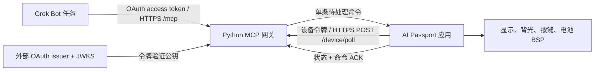

<p align="right">
  <strong>简体中文</strong> · <a href="grok-bot-mcp.md">English</a>
</p>

# 通过 MCP 让 Grok Bot 控制设备

## 范围与交付状态

第一阶段让 Grok Bot 通过自定义 MCP 连接器读取 AI Passport 状态、显示或清除短消息、调整背光。
设备主动向网关发送 HTTPS 请求，不在局域网开放服务器。持续语音对话延后。
本阶段不录音、不调用麦克风、不主动唤醒 Bot，也不提供任意 GPIO、Shell、文件或固件更新工具。

实现使用官方接口：Grok 自定义 MCP 连接器、官方 Python MCP SDK 和 ESP-IDF 网络 API。
不复制浏览器登录状态，不调用未公开的 Grok Bot 接口。目前未确认存在将某个具名 Bot
直接绑定到这块 ESP32 的官方 API。本文的“绑定”指授权连接器、在 Bot 任务中选择连接器，
并让网关对应一台已配置的设备。

用户要求提供方案和代码，暂不测试。本次交付状态：

```text
Build: NOT RUN
Host tests: NOT RUN
Device tests: NOT RUN
Unverified: 依赖安装、OAuth/身份提供方兼容性、公网 HTTPS 部署、Grok Bot 连接器发现、
固件构建、TLS/网络行为、屏幕渲染、命令确认、资源占用和设备按键行为。
```

生成代码期间未启动网关或隧道、未部署云服务、未调用业务 API，也未烧录。
下文配置与验收步骤均为后续操作，不代表已经完成验证。

## 官方接入边界

Grok 官方说明可在 `grok.com/connectors` 选择 **New Connector**、**Custom**，
填写 MCP URL 并完成认证，再在对话中使用服务暴露的工具。
参见官方 [Connectors 指南](https://docs.x.ai/grok/connectors)。

Grok 服务器必须能从公网访问 MCP 服务。局域网私有地址或 `localhost` 不能直接作为远程连接器地址。
需要托管网关或有认证保护的公网 HTTPS 隧道；隧道解决可达性，不替代授权。
参见 [Custom MCP Server Tunneling](https://docs.x.ai/grok/connectors/custom-mcp-tunneling)。

Grok Bot 官方说明通过 **Connect apps** 安装连接器，在任务中用 `@` 引用。
连接器对整个账户可用。给一个 Bot 命名为设备助手属于行为约定，不能隔离同账户下其他 Bot 的权限。
目标账户中的自定义连接器入口与 OAuth 流程仍需验证。
参见 [Use the computer and apps](https://docs.x.ai/grok-bot/computer-and-apps)。

## 架构与职责



| 组件 | 职责 |
| --- | --- |
| Grok 连接器 | 发现五个 MCP 工具，发起允许的操作 |
| 外部 OAuth 提供方 | 登录认证、用户授权、签发 access token、发布发现/JWKS 元数据 |
| Python 网关 | 验证 OAuth 令牌、校验输入、维护有界命令队列、报告状态与 ACK |
| 设备轮询任务 | 连接 Wi-Fi、获取 TLS 所需时间、轮询网关并交换状态/ACK |
| 应用状态与 UI | 应用支持的命令、执行本地控制规则、显示独立的设备控制界面 |
| 现有 BSP | 管理显示、背光、按键、电池、引脚和共享硬件资源 |

Kconfig 选项 `CONFIG_PASSPORT_GROK_MCP` 选择独立应用，默认 `n`，保留基线硬件测试 demo。
CMake 根据该选项选择应用源文件。
新应用拥有自己的启动入口和界面，不向测试菜单加页，也不复用 demo 视觉外壳。
不修改 BSP API、引脚映射或分区表。使用 ESP-IDF 自带网络组件，不引入外部固件组件包。

应用源文件为 [grok_app.c](../../../main/grok_app.c)、
[grok_protocol.c](../../../main/grok_protocol.c) 和 [grok_network.c](../../../main/grok_network.c)。
网关入口为 [server.py](../../../gateway/grok_bot/server.py)，配置、令牌验证和命令状态在同目录独立模块中实现。

## 工具与命令约定

| 工具 | 输入与行为 |
| --- | --- |
| `passport_get_status` | 返回最近设备状态、数据新鲜度和远程控制状态 |
| `passport_display_message(text)` | 入队 1 至 160 字符的可打印 ASCII 消息，允许换行 |
| `passport_clear_message` | 入队清除屏幕消息的操作 |
| `passport_set_backlight(brightness)` | 入队 10 至 100 的整数亮度百分比 |
| `passport_get_command_status(command_id)` | 按之前返回的命令 ID 查询接收与执行结果 |

消息 API 拒绝中文、其他非 ASCII 字符和除换行外的控制字符。这是第一阶段的明确能力边界：
基线 Montserrat 字体不能显示任意中文。后续中文支持必须遵循独立的
[字体接入流程](lvgl-chinese-fonts.zh_CN.md)，检查字形覆盖并验证真机显示。

轮询间隔为 2 秒。每次认证后的 `POST /device/poll` 上报当前状态和待回传的命令确认；
响应最多包含一条命令。设备凭证与 MCP OAuth 令牌相互独立。
网关最多维护八条待处理命令，其中最多一条执行中命令，自入队起有效期为 30 秒，
并保留最多 64 条终态命令结果。过期后停止继续派发，并将未确认命令标记为过期；
它无法撤回已经下发的命令，也不能撤销其影响。

MCP 写工具调用成功只代表网关接收了命令，不代表屏幕已经变化。
Bot 必须用返回的命令 ID 查询，收到设备 ACK 后才能报告成功。
超时、拒绝和缺少 ACK 都必须明确报告。ACK 证明固件处理结果，不替代对真实屏幕的视觉检查。

| 命令状态 | 含义 |
| --- | --- |
| `queued` | 已接收，等待轮询；`execution=not_sent` |
| `dispatched` | 已发给设备；收到 ACK 前为 `execution=unconfirmed` |
| `acknowledged` | 设备报告成功；`execution=confirmed` |
| `device_error` | 设备报告拒绝/失败；`execution=failed` |
| `expired` / `cancelled` | 停止派发；此前已发送但未确认的操作仍为 `unconfirmed` |
| `unknown` | 重启或历史淘汰后找不到 ID；不能作为成功证据 |

在收到 ACK 前，重复轮询可能取得同一条执行中命令。固件在本次启动内抑制重复应用。
重复调用 MCP 写工具会创建新命令；结果不确定时应查询现有 ID，不要自动重新提交。

15 秒未收到有效轮询后，状态为离线；旧状态必须保留数据年龄，不能伪装成实时数据。
设备报告新的启动标识或关闭远程控制时，网关取消旧的待处理/执行中命令。
设备本地也会在远程控制关闭时拒绝命令。本地关闭控制具有覆盖权，但不等于撤销 OAuth 凭证。

网关是单进程，状态仅保存在内存。重启会丢弃命令队列、命令历史和最近设备状态；
客户端重新连接，设备重新上报。不能使用多个 worker 或副本共享这套内存状态。
不承诺命令跨网关重启或设备重启保留。

## 本地界面与按键

屏幕显示应用标题、连接与远程控制状态、当前消息，并在右上角显示电量。
读不到电量时显示不可用，不显示成 0%。状态和消息使用现有支持 ASCII 的字体。

| 操作 | 行为 |
| --- | --- |
| `OK` 短按 | 立即暂停远程控制；网关确认暂停后才能恢复 |
| `UP` / `DOWN` 短按 | 本地调整亮度 |
| `OK` 长按 | 清除当前消息 |
| 60 秒无交互 | 背光降至 10% |
| 本地按键或已接收的远程命令 | 从空闲调暗状态唤醒屏幕 |

仅在本地配置有效后，启动时才默认允许远程控制。
配置缺失时显示原因，并保持远程控制不可用。远程控制关闭优先于收到的命令。
配置和设备控制不代表授予麦克风权限；本阶段不会启用音频采集。
暂停后，设备须收到一次已上报暂停状态的有效轮询响应，确认没有待投递命令，才允许恢复。
在此之前再次按 `OK` 不会恢复远程控制。断网期间保持暂停，本地调节亮度和清除消息仍可用。

按键回调只入队。控制任务和网络任务通过有界队列交换请求、结果和连接状态的副本。
网络任务不访问 LVGL 对象；控制任务修改屏幕时持有 `bsp_lvgl_lock()`，屏幕在整个启动周期内保持有效。
慢速 DNS、TLS 或 HTTP 请求不会阻塞本地控制。HTTP 操作设置 4 秒超时，并在 SDK 调用之间检查截止时间；
阻塞中的 SDK 调用仍可能超过该截止时间。请求超过 6 秒未返回时显示网关无响应，本地控制继续运行。

## 认证与部署条件

网关是 OAuth resource server，不自行实现 OAuth authorization server。
外部身份提供方需要满足：

- 支持 Authorization Code + PKCE，以及目标 Grok 自定义连接器支持的客户端注册方式。
- 签发 RS256 签名的 JWT access token，提供 HTTPS issuer/JWKS 地址。
- 令牌 audience 对应配置的公网 MCP resource URL，并包含 `passport:control` scope。
- 仅允许设备所有者访问。身份提供方策略与网关配置的所有者白名单必须一致；其他账户能登录并不够。

网关必须验证签名、issuer、audience、有效期、所有者身份和必要 scope。
ID token 不能替代 API access token。提供方注册与真实 Grok 兼容性属于必要外部配置；
代码不会让任意身份提供方自动兼容。
Access token 还须包含非空 `client_id` 或 `azp` claim，需要相应配置提供方的令牌 claim mapping。

设备使用独立随机令牌，只对应已配置的设备。不把令牌放入提示词、URL、日志或跟踪文件。
两个入口均使用有效证书的公网 HTTPS；设备通过 ESP-IDF 证书包验证服务器，建立 TLS 前先同步时间。
不能为了适配本地服务器而关闭 TLS 验证。
当前使用 `pool.ntp.org` 同步时间，网络须允许 DNS 和 UDP 123 端口的出站 SNTP；
时间同步失败时不会开始 TLS 轮询。

固件配置位于被忽略的 `main/grok_local_config.h`，由 `main/grok_local_config.example.h` 复制生成。
配置包含 Wi-Fi SSID/密码、公网 HTTPS 网关 origin、设备 ID 和设备令牌。
这能防止误提交凭证，但不会加密固件或 Flash；需要保护构建产物和实体设备。
提交的示例不包含真实凭证。通过手机配置网络是后续独立功能。

| 固件本地宏 | 含义 |
| --- | --- |
| `GROK_WIFI_SSID` / `GROK_WIFI_PASSWORD` | 本地 2.4 GHz Wi-Fi 凭证 |
| `GROK_GATEWAY_URL` | 仅 HTTPS origin，不带路径、query 或尾斜线 |
| `GROK_DEVICE_ID` | 与网关一致的设备 ID |
| `GROK_DEVICE_TOKEN` | 与网关一致的独立设备凭证 |

网关需要稳定的公网 origin，OAuth audience/resource URL 必须与最终 `/mcp` URL 对齐。
由选定托管平台或反向代理终结公网 TLS，仅开放 MCP、元数据和设备轮询所需路由。
部署、托管费用、域名、OAuth 注册和连接器授权均不包含在本次仅生成代码的任务中。

## 后续配置与构建

以下步骤仅在后续开始环境配置与验证时执行，本次没有运行。

1. 配置外部 OAuth 提供方和公网 HTTPS 网关入口，使 issuer、audience/resource URL、
   所有者和 scope 满足前文要求。
2. 使用网关的[依赖文件](../../../gateway/grok_bot/requirements.txt)和
   [环境变量示例](../../../gateway/grok_bot/.env.example)配置、启动单个进程。
   使用 Python 3.11 及以上；依赖固定为 `mcp==1.26.0` 和 `PyJWT[crypto]==2.10.1`。
   本次未安装依赖、未运行漏洞审计。真实凭证只放在本地环境配置或托管平台的 secret store。

   ```powershell
   python -m venv gateway/grok_bot/.venv
   .\gateway\grok_bot\.venv\Scripts\python.exe -m pip install -r gateway/grok_bot/requirements.txt
   # 启动前先导出必要的环境变量。
   .\gateway\grok_bot\.venv\Scripts\python.exe -m gateway.grok_bot.server
   ```

   程序不会自动加载示例文件，需要将值导出到进程环境。
   必填项为 `PASSPORT_PUBLIC_URL`（路径必须为 `/mcp`）、`PASSPORT_OAUTH_ISSUER`、
   `PASSPORT_OAUTH_JWKS_URL`、`PASSPORT_OAUTH_SUBJECT`（所有者 JWT 的准确 `sub`）、
   `PASSPORT_DEVICE_ID` 和 `PASSPORT_DEVICE_TOKEN`（32 至 128 个 URL-safe 随机字符）。
   `PASSPORT_PORT` 默认 8080。`PASSPORT_ALLOWED_ORIGINS` 可选，用逗号分隔准确的 HTTPS 浏览器 origin；
   留空时接受没有 Origin header 的客户端，拒绝带浏览器 origin 的请求。

   服务只监听 `127.0.0.1`。外部 HTTPS 反向代理必须保留配置的公网 Host，清除不可信转发头。
   不直接暴露明文 HTTP 监听地址，不启动多个 worker。
3. 在仓库根目录准备固件本地配置：

   ```powershell
   Copy-Item main/grok_local_config.example.h main/grok_local_config.h
   ```

   填写本地副本中的必填字段。设备 ID/令牌必须与网关一致。
   设备网关设置填写 origin，不填写 `/mcp` URL。
4. 在已激活的 ESP-IDF 5.5.3 环境选择应用并构建：

   ```powershell
   idf.py menuconfig
   idf.py build
   ```

   在 **AI Passport application** 中启用 **Use the Grok Bot MCP device application**，
   保存 `CONFIG_PASSPORT_GROK_MCP=y`。构建前确认生成的 `sdkconfig` 已包含该设置。
   选项关闭时仍可构建基线。仓库门禁若从跟踪的默认配置构建，选中的是基线；
   基线门禁通过不能证明这个可选应用通过验证，必须单独验证明确启用功能的构建。
   后续固件交付前，按[构建与测试指南](build-and-test.zh_CN.md)
   执行完整验证门禁。本次源码未经验证，烧录需要单独的明确交接与批准。
5. 在 Grok 自定义连接器中加入公网 `https://<gateway-host>/mcp` 地址，完成身份提供方的 OAuth 流程。
   在目标 Bot 任务中使用可用的应用入口选择连接器。确认能发现全部五个工具；
   目标账户是否开放对应能力仍属于验收项目。

连接后的 Bot 指令示例：

> 使用 AI Passport 连接器操作此设备。发送命令前先读取状态，只使用列出的工具和可打印 ASCII 消息。
> 命令入队不代表完成：按命令 ID 查询，只有收到设备 ACK 后才报告成功。遵守离线和远程控制关闭状态。

这段指令引导工具使用。即使 Bot 忽略指令，网关认证和设备端校验仍应执行权限限制。

## 资源与设计取舍

轮询避免在设备端开放入站服务，使第一阶段实现更小。命令入队后，名义上需要等待 0 至 2 秒被下一次轮询取走，
此外还有网络与调度延迟。这是估算，不是测量结果或 SLA。持续语音需要另外设计流式传输和会话机制。

现有板级分配包括 24 KB LVGL pool 和约 9.6 KB LCD DMA 缓冲。
控制任务和网络任务的栈分别配置为 6 KB、8 KB；有界队列的载荷数据约 2 KB，另有队列管理开销。
这些配置值不是实测峰值；Wi-Fi 和 TLS 还有与实现有关的分配。
ESP32-C3 没有 PSRAM。长期运行验收前应测量最低空闲堆、最大连续空闲块和任务栈最低剩余量。
本次未测量运行内存或延迟。

单进程网关适合一台配置设备，命令归属明确，代价是不持久化且不能多副本高可用。
未来若使用共享存储，需要先定义投递、去重、过期、权限和重启语义，再考虑横向扩容。

## 后续验收清单——未执行

- 构建两种应用选择，运行要求的主机测试与静态门禁。
- 验证 MCP 拒绝未认证、错误所有者、错误 audience、过期、错误 scope 和签名无效的请求；
  设备入口独立拒绝错误设备令牌，日志不能泄露凭证。
- 完成真实 Grok 自定义连接器 OAuth 流程，发现五个工具，确认目标 Bot 任务中可用。
- 读取实时状态；设备断网超过 15 秒，确认离线状态和旧数据年龄。
- 显示 1 和 160 字符消息；拒绝空消息、161 字符消息、中文、其他非 ASCII 字符和除换行外的控制字符。
  在实际屏幕检查换行与清除。
- 验证亮度 10 和 100 的边界；拒绝越界和非整数输入。检查本地按键、空闲调暗与唤醒。
- 确认工具先返回入队的命令 ID，收到 ACK 后才报告完成。检查 ACK 丢失、重复投递、队列满、
  设备拒绝和 30 秒后命令过期。
- 在命令投递前及投递中关闭远程控制，确认取消待处理工作，收到的命令不能改变屏幕；
  重新打开时不重放旧命令。检查快速暂停/恢复和慢速、阻塞的 HTTP 响应：暂停持续生效、
  本地按键仍响应，恢复必须等待有效的暂停轮询响应。
- 有待处理/执行中命令时重启设备，确认新启动标识使旧命令失效。重启网关后确认状态清空、
  客户端重连，命令不会静默重放。
- 检查 Wi-Fi 断线/重连、时间同步失败、证书无效和长期轮询。观察任务/堆稳定性及电池缺失时的降级。
  HTTP 请求成功不代表屏幕显示正确。

## 第二阶段边界

持续语音是独立需求，需要官方支持的音频/会话接口、用户同意与麦克风控制、流式缓冲、轮次检测、
打断机制以及实测内存预算。这些 MCP 控制工具没有实现音频通道，也没有创建未公开的具名 Bot 语音接口。
